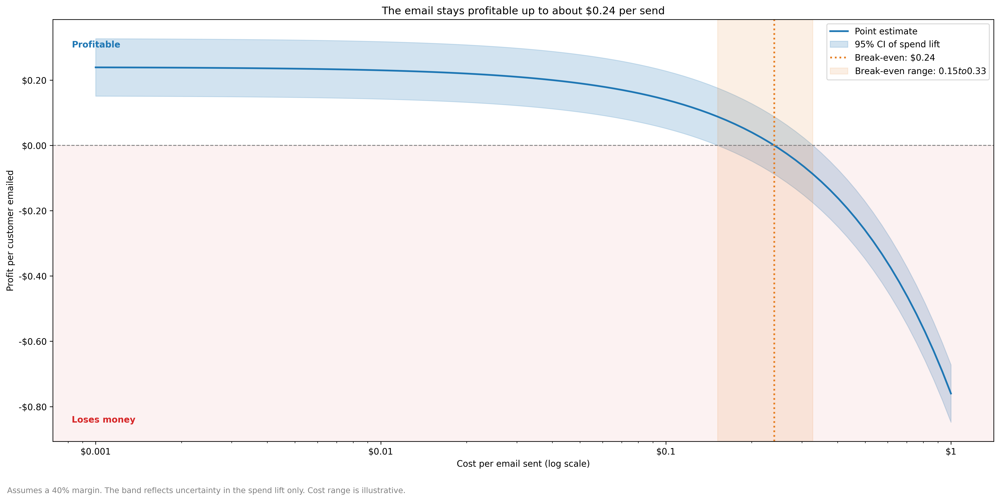

# Do emails pay off? Measuring the impact of email marketing on conversion and spend

*Does sending a marketing email increase purchases and spending, and does the extra revenue cover the cost of sending it?*

Among customers who received an email, many would have bought anyway, so counting their purchases overstates the campaign’s impact. What matters are the purchases that happened because of the email.

To isolate that effect, I analyzed the Hillstrom email marketing experiment, in which [64,000] customers were randomly assigned to receive one of two emails or no email at all. Because assignment was random, the groups are comparable, and any difference in outcomes can be attributed to the email.

I compared conversion and spend between the email and no-email groups, put confidence intervals around the differences, and estimate the campaign’s ROI under an assumed cost per email.

## Dataset description

The analysis uses the Hillstrom Email Marketing dataset, which contains  64,000 customers randomly assigned to one of three group groups:

- Mens E-Mail
- Womens E-Mail
- No E-Mail

Each row is a customer. Some variables were recorded before the email was sent, and some were recorded afterwards.

The variables are:
| Variable | Description |
|---|---|
| `segment` | Experimental group assignment |
| `recency` | Months since the customer's last purchase |
| `history` | Historical customer spending |
| `mens` | Previous purchasing activity for men's merchandise |
| `womens` | Previous purchasing activity for women's merchandise |
| `newbie` | Whether the customer is new |
| `channel` | Customer acquisition channel |
| `visit` | Whether the customer visited the website |
| `conversion` | Whether the customer made a purchase |
| `spend` | Amount spent during the measurement period |

## Exploratory data analysis

The analysis relies on random assignment making the three groups comparable, so that any difference in outcomes can be attributed to the email. Before looking at outcomes, I checked whether the pre-email characteristics look similar across groups.

### Assessing experimental group balance

**Categorical variables**

I ran chi-square tests of independence between group and category, and used Cramér’s V to measure the size of any association for the `newbie`, `channel`, `zip_code`, `mens` and `womens` columns.

**Numerical variables**

I ran  one-way ANOVA tests to investigate differences in `recency` and `history` across the experimental groups.

**Results**
The table below shows the p-values from the balance tests:

| Feature | P-value | Outcome |
|---|---:|---|
| `newbie` | 0.933855 | No significant difference |
| `channel` | 0.458034 | No significant difference |
| `zip_code` | 0.579479 | No significant difference |
| `mens` | 0.671664 | No significant difference |
| `womens` | 0.728869 | No significant difference |
| `recency` | 0.763083 | No significant difference |
| `history` | 0.698036 | No significant difference |

None of the seven tests found evidence of a difference between groups, and all effect sizes were very small. Seven tests at the 5% level would produce a false alarm about a third of the time by chance alone, so a single significant result would not have been worrying either.

The SMDs in the plot below give a more direct check. Every covariate is below the conventional 0.1 threshold, so the groups look alike on the characteristics I can observe.

Love plot showing standardized mean differences between each email group and the control group for all pre-email variables. All values fall below the 0.1 threshold.

*Figure 1. Standardized mean differences between each email group and the control. Points left of the dashed line at 0.1 indicate good balance.*

## Calculating lift
Lift measures the effect of the email. For example, it tells you how much did conversion change for customers who received one compared with those who didn’t?

Here I compare customers who received either email (Men’s or Women’s, combined) with the no-email control group.

### Visit
Customers who received an email were much more likely to visit the website.
| Metric | Result |
|---|---:|
| Absolute visit lift | 6.09 percentage points |
| Relative visit lift | 57.35% |
| Z-statistic | 20.5101 |
| P-value | 1.75 × 10⁻⁹³ (p < 0.001) |
| 95% confidence interval | [5.54, 6.63] percentage points |

In practical terms, that’s about 6 additional visits for every 100 customers emailed. A two-proportion z-test gives very strong evidence that this isn’t due to chance, and the confidence interval is well above zero.

### Conversion rate
Visits are only useful if they lead to purchases, so I looked at conversion next.

| Metric | Result |
|---|---:|
| Absolute conversion lift | 0.50 percentage points |
| Relative conversion lift | 86.53% |
| Z-statistic | 6.2438 |
| P-value | 4.27 × 10⁻¹⁰ (p < 0.001) |
| 95% confidence interval | [0.35, 0.63] percentage points |

That works out to about 5 additional purchases for every 1,000 customers emailed. The email group converted at nearly twice the control rate, though from a low baseline, which is why the absolute figure is the more useful one for business decisions. The z-test provides strong evidence of a real effect, and because the interval doesn’t include zero, a true effect of zero is not plausible.
### Spend
Finally, did the extra purchases translate into revenue?
| Metric | Result |
|---|---:|
| Absolute spend lift | 0.60 |
| Relative spend lift | 91.42% |
| T-statistic | 5.3022 |
| P-value | < 0.001 |
| 95% confidence interval | [0.38, 0.82] |

Customers who received an email spent an average of [$]0.60 more than those who didn’t, a 91.42% increase. This figure is per customer emailed, including the many who bought nothing, which makes it the right basis for the ROI calculation. A two-sample t-test shows the difference is statistically significant, and the interval, [$0.38, $0.82], excludes zero.

Emailing customers increased visits, conversion and spend relative to sending nothing, and each effect is statistically significant. The effects are also consistent. More customers visited the site, more of them bought, and their average spend rose. These results show the email works.

## Is the email worth sending?
A campaign that increases conversions, spend and visits can still lose money if it costs more to run than it earns. This section asks how much the retailer could afford to spend per emailed customer and still make a profit.

Each customer emailed generates some additional revenue, but only a portion of that revenue contributes to profit. Sending the email also has a cost. Therefore, estimated profit per customer emailed is:
Profit per customer = (extra spend × margin) − cost per email.

The dataset contains no information about campaign costs or margins. Since the experiment dates back to 2008, I also can't establish what sending these emails actually cost at the time. Rather than assume a single cost, I calculate estimated profit across an illustrative range of $0.001 to $1.00 per email.

Input	Value	Source
Extra spend per customer emailed	$0.60 (95% CI: $0.38 to $0.82)	Measured in the experiment
Profit margin	[40%]	Assumption
Cost per email	$0.001 to $1.00	Illustrative range

At a 40% contribution margin, the estimated break-even email cost is $0.24 per customer. The confidence interval gives a break-even range of approximately $0.15 to $0.33.

The plot shows estimated profit declining as the cost of sending each email increases. At very low costs, estimated profit is approximately $0.24 per customer. The shaded confidence band shows how this estimate changes when we account for uncertainty in the measured spend lift.

*Figure 2. Estimated profit per customer emailed across an illustrative range of email costs, assuming a 40% contribution margin.*

This analysis excludes other potential costs, including creative work, marketing tools, discounts and other campaign expenses.
### Conclusion
The email campaign is very likely profitable. It earns more than it costs unless each send costs more than roughly 15 to 33 cents, far above [what an email typically costs](https://mailmeteor.com/glossary/email-price). That confirms the campaign works on average. It doesn’t tell us whether some customers respond much more than others, or whether a few are better left alone.