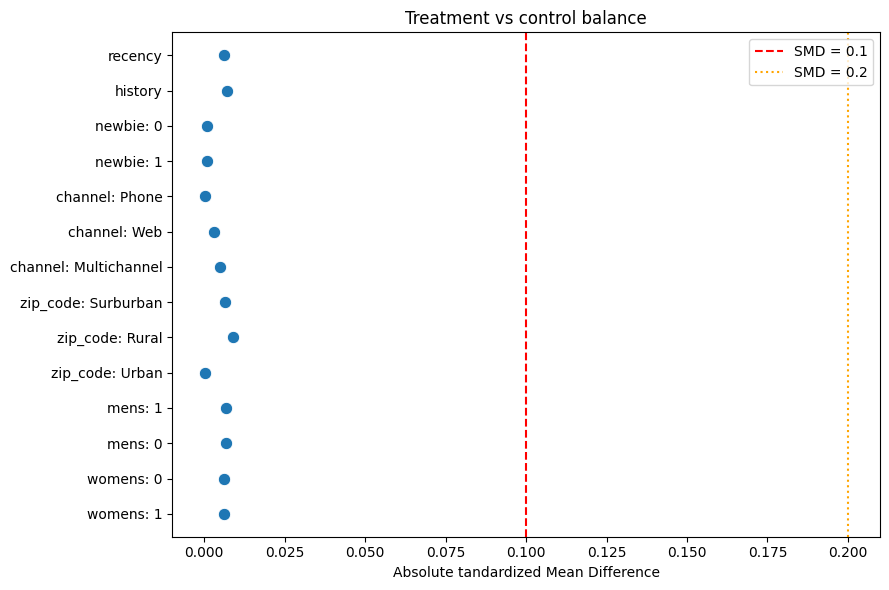

# Do emails pay off? Measuring the impact of email marketing on conversion and spend

*Does sending a marketing email increase purchases and spending, and does the extra revenue cover the cost of sending it?*

Among customers who received an email, many would have bought anyway, so counting their purchases overstates the campaign’s impact. What matters are the purchases that happened because of the email.

To isolate that effect, I analyzed the Hillstrom email marketing experiment, in which [64,000] customers were randomly assigned to receive one of two emails or no email at all. Because assignment was random, the groups are comparable, and any difference in outcomes can be attributed to the email.

I compared conversion and spend between the email and no-email groups, put confidence intervals around the differences, and estimate the campaign’s ROI under an assumed cost per email.

## Dataset description

The analysis uses the Hillstrom Email Marketing dataset, which contains  64,000 customers randomly assigned to one of three group groups:

- Mens E-Mail
- Womens E-Mail
- No E-Mail

Each row is a customer. Some variables were recorded before the email was sent, and some were recorded afterwards.

The variables are:
| Variable | Description |
|---|---|
| `segment` | Experimental group assignment |
| `recency` | Months since the customer's last purchase |
| `history` | Historical customer spending |
| `mens` | Previous purchasing activity for men's merchandise |
| `womens` | Previous purchasing activity for women's merchandise |
| `newbie` | Whether the customer is new |
| `channel` | Customer acquisition channel |
| `visit` | Whether the customer visited the website |
| `conversion` | Whether the customer made a purchase |
| `spend` | Amount spent during the measurement period |

## Exploratory data analysis

The analysis relies on random assignment making the three groups comparable, so that any difference in outcomes can be attributed to the email. Before looking at outcomes, I checked whether the pre-email characteristics look similar across groups.

### Assessing experimental group balance

**Categorical variables**

I ran chi-square tests of independence between group and category, and used Cramér’s V to measure the size of any association for the `newbie`, `channel`, `zip_code`, `mens` and `womens` columns.

**Numerical variables**

I ran  one-way ANOVA tests to investigate differences in `recency` and `history` across the experimental groups.

**Results**
The table below shows the p-values from the balance tests:

| Feature | P-value | Outcome |
|---|---:|---|
| `newbie` | 0.933855 | No significant difference |
| `channel` | 0.458034 | No significant difference |
| `zip_code` | 0.579479 | No significant difference |
| `mens` | 0.671664 | No significant difference |
| `womens` | 0.728869 | No significant difference |
| `recency` | 0.763083 | No significant difference |
| `history` | 0.698036 | No significant difference |

None of the seven tests found evidence of a difference between groups, and all effect sizes were very small. Seven tests at the 5% level would produce a false alarm about a third of the time by chance alone, so a single significant result would not have been worrying either.

The SMDs in the plot below give a more direct check. Every covariate is below the conventional 0.1 threshold, so the groups look alike on the characteristics I can observe.

Love plot showing standardized mean differences between each email group and the control group for all pre-email variables. All values fall below the 0.1 threshold.

*Figure 1. Standardized mean differences between each email group and the control. Points left of the dashed line at 0.1 indicate good balance.*